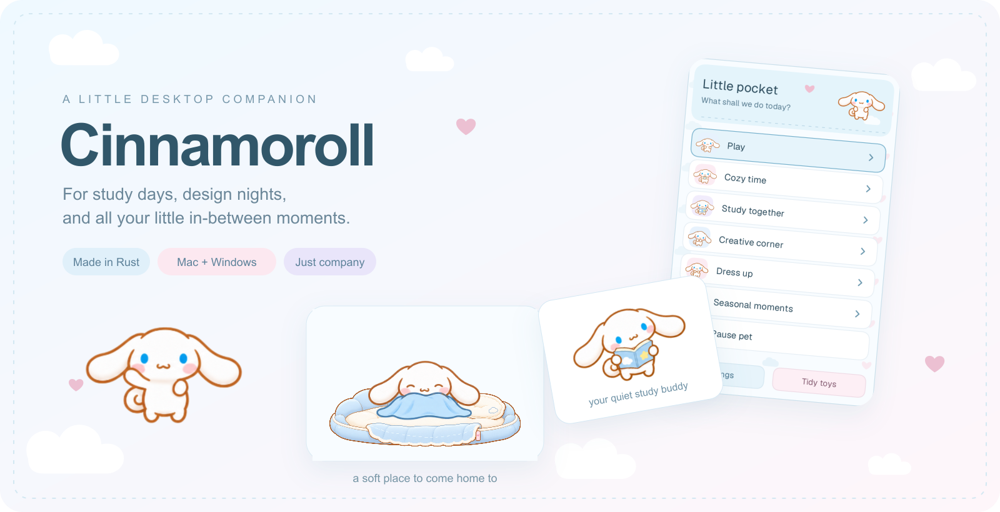
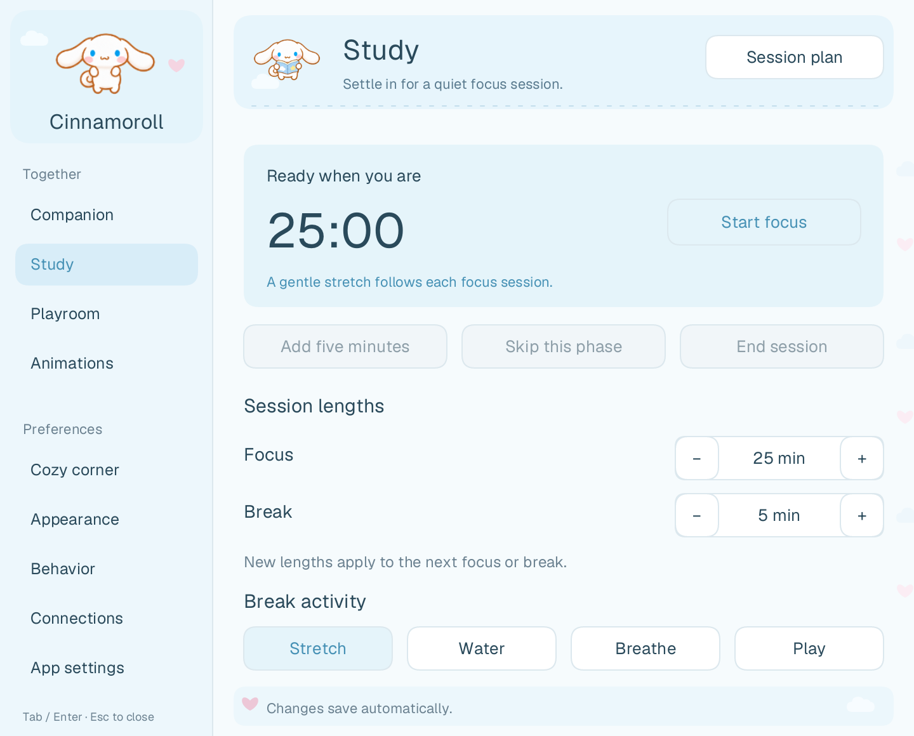
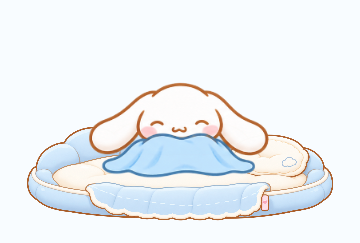

<p align="center">
  
</p>

<p align="center">
  <strong>A soft little companion for your desktop.</strong><br>
  He studies beside you, gets distracted by toys, and always has a cozy place to come home to.
</p>

<p align="center">
  <a href="https://github.com/ShindouMihou/cinnamoroll-desktop/releases">☁️ Downloads</a> ·
  <a href="#a-little-company">Meet Cinnamoroll</a> ·
  <a href="#bring-him-home">Get started</a> ·
  <a href="docs/DEVELOPMENT.md">Build your own</a>
</p>

<p align="center">Rust · native macOS + Windows · local-first · no browser runtime</p>

<p align="center"></p>

## A little company

Some days call for a study buddy. Some call for a tiny friend in a blanket.

- **Pick him up.** Click for a reaction, stroke his head, boop his nose, or carry him around with his little hanging animation.
- **Open his pocket.** Right-click for a small collection of things to do together: play, cozy time, study, creative moments, and dress-up.
- **Settle in to study.** Focus and break timers, favorite study presets, one little task, and a quiet reading buddy.
- **Make a cozy corner.** A plush cloud bed, blanket colors, sleepy moments, and a gentle walk home after he’s been away for a while. Drag the bed to carry both when he’s settled on it.
- **Bring the toys to him.** Offer treats, roll a ball, pop bubbles, follow a little star through shuffled cups, or try the ribbon, toy wand, and paper plane.
- **Let little moments happen.** Spaced-out idle activities, shy smiles, ear wiggles, dancing, seasonal surprises, and optional nearby treats to offer.
- **Make him yours.** Bows, scarves, hats, little bags, palette play, and transparent sticker exports.
- **Keep it comfortable.** Pet sizes, reduced motion, quiet-time controls, automatic sleep, and a clean native settings panel.

He can also listen along with supported music players and browser media sessions. Optional cursor visits use position information only—he doesn’t read what you type or inspect your screen.

<table>
<tr>
<td align="center" width="50%"><strong>A quiet study buddy</strong><br><br></td>
<td align="center" width="50%"><strong>A soft place to land</strong><br><br><br><br><em>Small adventures. Very important naps.</em></td>
</tr>
</table>

## Bring him home

Install the latest published release with one line:

**macOS**

```sh
curl -fsSL https://raw.githubusercontent.com/ShindouMihou/cinnamoroll-desktop/main/install.sh | sh
```

**Windows PowerShell**

```powershell
irm https://raw.githubusercontent.com/ShindouMihou/cinnamoroll-desktop/main/install.ps1 | iex
```

The Mac installer uses `/Applications`, with `~/Applications` as a fallback when needed. Windows uses `%LOCALAPPDATA%\Programs\Cinnamoroll` and adds a Start Menu shortcut. Both verify published release checksums, preserve preferences, and keep the installation writable for silent updates. No administrator prompt is needed for the default Windows location. [Installer source](install.ps1) · [Mac installer source](install.sh).

Prefer a ZIP? Manual downloads work too.

The first checkpoint is **v0.1.2**. Release downloads appear on the [Releases page](https://github.com/ShindouMihou/cinnamoroll-desktop/releases) once published.

| Your computer | What to download | Then… |
| --- | --- | --- |
| macOS 13+, Apple Silicon | `Cinnamoroll-VERSION-aarch64-apple-darwin.zip` | Unzip, move `Cinnamoroll.app` to a permanent writable location, and open it. |
| macOS 13+, Intel | `Cinnamoroll-VERSION-x86_64-apple-darwin.zip` | Unzip, move `Cinnamoroll.app`, and open it. |
| Windows 10 / 11, x64 | `Cinnamoroll-VERSION-x86_64-pc-windows.zip` | Extract the whole folder and open `Cinnamoroll.exe`. Keep `SDL3.dll` beside it. |

No Rust installation is needed to use a release. The Windows tray icon may be under the little **^** beside the clock. If the Mac menu-bar item isn’t visible, focus Cinnamoroll and press **S** to open settings.

These early builds use an ad-hoc Mac signature and an unsigned Windows executable. OS distribution signing and Mac notarization are separate from the signed update channel.

### His little shortcuts

| Gesture / key | A little moment |
| --- | --- |
| Click / stroke his head | Affection and touch reactions |
| Drag Cinnamoroll | Pick him up and carry him |
| Right-click / **Q** | Open the little pocket |
| **S** | Settings |
| **F** / **N** | Snack / tuck in or wake |
| **T** / **E** | Start or stop chase / edge peek |
| **Space** | Pause or resume |
| Right-click a toy / **Tidy toys** | Leave the current play mode |
| **Esc** | Close a pocket, settings, or toy; quit when the pet itself is focused |

Keyboard shortcuts apply while Cinnamoroll, his bed, or the relevant control has focus.

<p align="center"></p>

## New little things, delivered

**App settings** keeps startup and updates together. Automatic update checks and **Update while away** start on and can be switched off independently.

Once a stable release is published, Cinnamoroll checks quietly at most once a day. You can check manually, download an update, and choose **Install & restart**. With **Update while away** enabled, he can download, install, and relaunch after **one hour without computer input**. Study sessions and open controls defer unattended installation; returning input before the final swap cancels that attempt.

Every downloaded update must pass the embedded signing-key check. Updates replace the complete app folder so artwork, native libraries, and the executable stay together. A failed folder swap restores the previous copy, and settings stay in your user profile.

Release signing and publishing instructions live in [the release guide](docs/RELEASING.md). A draft release is never offered as an automatic update.

## Small by design

Cinnamoroll uses **Rust + SDL3**, a native renderer, and prepared animation strips. There’s no Electron, embedded browser, account, analytics, or AI service. Only the current activity’s composed frames are cached, and update work runs on demand rather than in a permanent service.

Music and typing-cursor reactions are optional. Cursor following stores no typed text. Preferences stay on your computer; networking is used for enabled GitHub update checks and downloads.

Want to tinker? See [Development](docs/DEVELOPMENT.md), [Release preparation](docs/RELEASING.md), and [third-party notices](THIRD_PARTY_NOTICES.md). Small fixes, more thoughtful interactions, and platform testing are welcome.

<p align="center"></p>

<p align="center">
  <br>
  <strong>Thanks for keeping him company. ♡</strong><br><br>
  <sub>Independent fan project. Cinnamoroll belongs to Sanrio.<br>Source code: <a href="LICENSE">MIT</a>. Character artwork and dependencies retain their respective rights.</sub>
</p>
